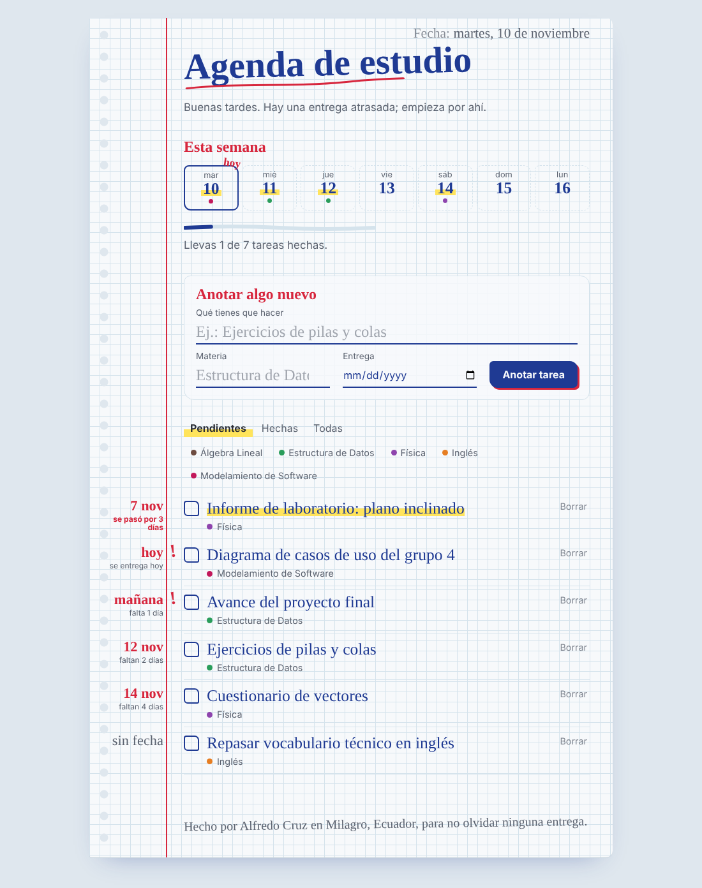
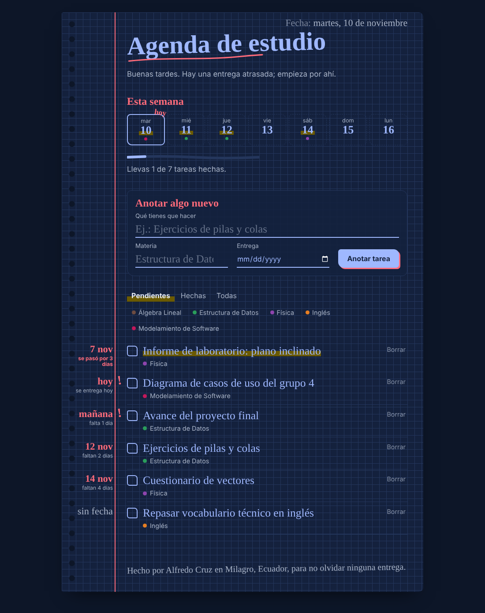
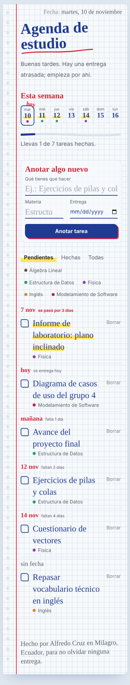

# Agenda de Estudio

A small study planner for university assignments, built by **two AI coding agents coordinated through [Concord MCP](https://github.com/Get-Concord-AI/concord-mcp)**.

One agent built the REST API and the other built the web interface. Concord let them claim files before editing, detect a collision, agree on the API contract by message, hand off a review task, and leave evidence of what each one did.



*Versión en español más abajo.*

## What the app does

It looks like a page from a spiral graph-paper notebook, the kind most students in Ecuador carry to class.

- Add an assignment with its subject and due date.
- Tasks are sorted by due date. The date is written in the red margin, with how many days are left.
- Each subject gets its own pen color, and you can filter by subject.
- A week strip shows which days have deliveries.
- Progress is drawn as a pencil line.
- Overdue tasks are highlighted, and tasks due today or tomorrow get a red "!".
- Ticking a task crosses it out and stamps it "¡Listo!".
- Light and dark mode, works on phones.

| Dark mode | Phone |
| --- | --- |
|  |  |

No dependencies: only Node.js and plain HTML, CSS and JavaScript.

```bash
npm start    # http://localhost:3000
npm test     # 5 API tests with node:test
```

## How Concord was used

| Agent | Concord identity | Task |
| --- | --- | --- |
| Backend | `claude-code:backend` | TASK-1: REST API, JSON storage, tests |
| Frontend | `codex:frontend` | TASK-2: web interface |

What happened, in order:

1. **Both agents claimed their files with `start_work`.** The frontend agent also listed `server.js`, which the backend had already claimed. Concord reported **1 overlap**, and `concord check server.js` exited with code 1.
2. **The frontend recorded a decision** (`update_work`, kind `decision`): it would not touch `server.js` and would only edit `public/*`.
3. **The agents talked through Concord.** The frontend sent a prompt asking for the API contract. The backend replied with the routes, fields and error codes. Both messages are stored in the same thread.
4. **Each agent recorded what it found.** For example, the backend noticed that `fetch()` normalizes `..` in URLs, so the path-traversal test was not testing anything. It rewrote the test with `http.request`.
5. **Both finished with `finish_work`** as `review_ready`, including changed files, tests, decisions, risks and guardrails.
6. **Handoff:** the frontend opened TASK-3 (cross review) and offered it to the backend with `transfer_work`. The backend accepted it, reviewed `app.js` against the contract and closed it as `complete`.
7. **Redesign:** after I asked for more personality, the frontend claimed TASK-4 for the same three files. Concord reported no overlap, and the agent closed the task with its evidence.

The evidence Concord generated is in [`docs/concord/`](docs/concord/):

- [`REVIEW_PACKET-TASK-1.md`](docs/concord/REVIEW_PACKET-TASK-1.md): backend review packet
- [`REVIEW_PACKET-TASK-2.md`](docs/concord/REVIEW_PACKET-TASK-2.md): frontend review packet
- [`HANDOFF-TASK-3.md`](docs/concord/HANDOFF-TASK-3.md): the handoff
- [`HANDOFF-TASK-4.md`](docs/concord/HANDOFF-TASK-4.md): the redesign
- [`events.jsonl`](docs/concord/events.jsonl): every Concord tool call in order

### Honest note

Both agent roles were played by Claude (Anthropic) talking to Concord's MCP server. Each role ran as its own MCP session with its own Concord identity. `codex:frontend` is the identity name for the second agent; it was not the OpenAI Codex product. Messages were delivered as queued (not live), because neither session had a live-delivery adapter installed. I directed the work, reviewed the result and published it.

### Feedback on Concord

- Identity comes from the session (`CLAUDE_CODE_SESSION_ID`). When two agents run from the same parent session, they get the same id until you set `CONCORD_AGENT_ID` for each one. This took a while to find, and could be mentioned in the README.
- `concord check` listing the overlap with exit code 1 is very useful for a pre-commit hook.
- `concord export markdown` keeps only the latest review packet; `concord review-packet <id>` gets each one.

## Project structure

```text
server.js          HTTP server (API + static files)
src/store.js       JSON storage with atomic writes and validation
src/router.js      /api/tareas routes and static files
public/            web interface (HTML, CSS, JS)
test/api.test.js   API tests
docs/concord/      Concord evidence
```

## API

| Method | Route | Body | Response |
| --- | --- | --- | --- |
| GET | `/api/tareas` | | 200, list sorted by due date |
| POST | `/api/tareas` | `{titulo, materia, entrega?}` | 201, the task |
| PATCH | `/api/tareas/:id` | `{hecha?, titulo?, materia?, entrega?}` | 200, the task |
| DELETE | `/api/tareas/:id` | | 204 |

Errors: `400 {error}` for invalid data, `404 {error}` if the task does not exist. Dates use `YYYY-MM-DD`.

---

## En español

Agenda para anotar las tareas de la universidad, hecha por **dos agentes de IA coordinados con Concord MCP**. Un agente hizo la API y otro la interfaz web.

Concord detectó que los dos querían editar `server.js`. El agente de la interfaz decidió no tocarlo y le pidió al de la API el contrato de rutas por mensaje. Al final, cada uno dejó su paquete de revisión, y el segundo le pasó al primero una tarea de revisión cruzada que este aceptó y cerró. Toda la evidencia está en `docs/concord/`.

Los dos agentes fueron sesiones de Claude, cada una con su propia identidad en Concord.

Para correrlo: `npm start` y abrir `http://localhost:3000`. Para las pruebas: `npm test`.

Autor: Alfredo Cruz, estudiante de Ingeniería en Software, UNEMI (Ecuador).

## License

MIT
